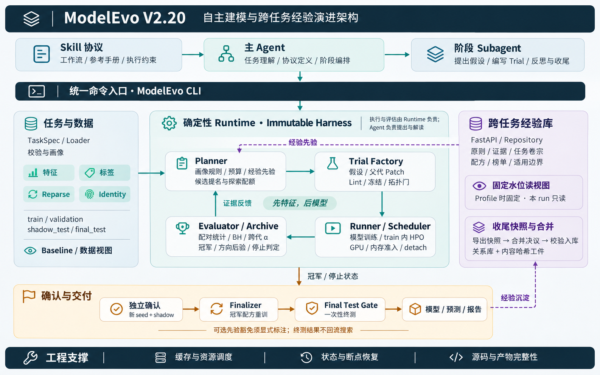

# ModelEvo

**面向结构化与表格数据的自动建模 Agent，支持二分类、回归和 uplift。**

给定数据、业务目标与验证方案，ModelEvo 在预算内探索特征、数据视图、模型和超参数，交付模型、预测与实验报告，并积累可供后续任务验证复用的经验。

核心理念是 **LLM 提出假设，确定性 Runtime 执行与裁决**：Coding Agent 理解业务和数据、编写实验并解释结果；Runtime 固定数据与评估协议，负责训练、统计裁决、资源调度和交付校验。

[快速开始](#快速开始) · [效果展示](#效果展示) · [架构与流程](#架构与流程) · [仓库导航](#仓库导航) · [详细文档](#详细文档)

## 🔥 News

- **2026.11.04｜发布 ModelEvo V2.0**：新增自动建模 Skill `model-evolution-skills/model-evolution-skill/`，包含特征与数据视图探索、模型与超参搜索、确认与交付门、跨任务经验库；支持二分类、回归和 uplift。
- **2026.09.07｜发布特征挖掘智能化**：`feature-mining-skills/` 提供特征进化与语义特征挖掘，形成候选生成、确定性评估与反馈演进的闭环。
- **2026.07.10｜发布 V1.0**：`model-skills/` 提供覆盖需求采集、样本准备、特征工程、训练、评估与归档的业务建模 Skill 集合，支持分类与 uplift。

> **Status:** Public release (V2.0);

## 核心能力

- **自主搜索**：先探索特征和数据视图，再搜索模型与超参数；按代批量试验，根据证据调整方向，并支持断点恢复。
- **可信评估**：固定任务与评估协议，通过配对统计、选择校正和确认机制控制偶然选优风险。
- **经验复用**：可选经验库保存原则、证据与模型配方，为后续任务提供检索和 warm-start；历史经验仍需在当前任务验证。
- **完整交付**：输出重训模型、预测、训练历程与结果报告，保留实验代码、配置和裁决记录。

## 快速开始

### 运行环境与前置依赖

- Linux / macOS，建议 Python 3.10 及以上。
- 能加载 `SKILL.md`、执行 Python 并编写实验代码的 Coding Agent；下面以 Claude Code 为例。
- 一份具有明确标签含义的本地 CSV / Parquet 样本。V2 本地首跑不需要 Spark，经验库也可关闭。

### 1. 获取代码与安装依赖

```bash
git clone https://github.com/QFIN-tech/model-evo.git
cd model-evo

python3 -m venv .venv
source .venv/bin/activate
export MODELEVO_SKILL_DIR="$PWD/model-evolution-skills/model-evolution-skill"
python -m pip install -r "$MODELEVO_SKILL_DIR/runtime/requirements.txt"
python "$MODELEVO_SKILL_DIR/scripts/modelevo.py" --version
```

当前版本应输出 `2.20.0`。V2 的 Skill 根目录是 `model-evolution-skills/model-evolution-skill/`，其中包含 `SKILL.md`、`runtime/` 和 `scripts/`。

### 2. 安装 Skill

以下为首次安装，将 V2 的 Skill 根目录链接到 Claude Code 的用户级 Skill 目录：

```bash
mkdir -p "$HOME/.claude/skills"
ln -s "$MODELEVO_SKILL_DIR" "$HOME/.claude/skills/modelevo"
```

若目标已存在，先检查它是否指向上述 V2 目录。使用其他 Agent 时，按其 Skill 加载方式配置同一目录。

### 3. 启动一次冷启动建模

在同一个终端中保持 Python 环境已激活。首次体验显式关闭经验库，再进入数据项目目录启动 Agent：

```bash
export MODELEVO_LIBRARY_ENABLED=0
cd examples/model-classification-example1
# 在此目录启动 Coding Agent
```

发送以下提示词即可使用仓库自带样本：

```text
使用 modelevo skill，对 data/sample.csv 建立信用卡违约二分类模型。
目标列为 default payment next month，1 表示下个月违约，以 AUC 为主指标。
```

也可以提供自己的数据绝对路径、标签定义、真实观测时间与标签时间窗、验证方案和预算。Agent 会检查数据并补全任务协议；业务定义或泄漏列无法可靠判断时，会请求确认。示例数据的来源、授权和字段说明见[分类示例](examples/model-classification-example1/README.md)。

### 4. 查看交付结果

在 Agent 给出的运行目录中查看：

| 位置 | 内容 |
|---|---|
| `report/report.html` | 训练历程与实验结果 |
| `report/report.md` | 结果摘要与交付状态 |
| `final-model/` | 通过交付门后的重训模型、预测与评估产物 |
| `trials/` | 搜索阶段的实验代码、配置和工件 |

若预算内没有满足交付条件的候选，报告会说明原因。`final-model/unconfirmed/` 中的产物仍属未确认状态，不能仅凭目录中有模型就视为正式交付。

### 5. 启用跨任务经验库（可选）

需要复用历史经验时，按 [V2 使用说明](model-evolution-skills/model-evolution-skill/README.md#5-启用经验库可选)配置并启动经验服务，再以启用经验库的环境启动 Agent 创建新任务。关闭服务与主动禁用经验库含义不同：服务不可达时可能使用本机缓存；完全冷启动需显式设置 `MODELEVO_LIBRARY_ENABLED=0`。

## 效果展示

### 公开数据集：冷启动建模

在本次 **5 个公开数据集、固定切分、关闭历史经验**的评测中，ModelEvo 在 6 个单模型条目中取得最佳平均名次 **1.60**，其中 3 个数据集点估计排名第一。

| 数据集（指标） | ModelEvo | AIDE 单模型 | raw-agent 单模型 | AutoGluon 单模型 | FLAML | TabPFN v2 |
|---|---|---|---|---|---|---|
| home_credit（AUC ↑） | **0.79315** | 0.76813 | 0.76773 | 0.77318 | 0.78634 | 0.73524 |
| creditcard（AUC ↑） | **0.99601** | 0.98654 | 0.99423 | 0.92278 | 0.96664 | 0.98399 |
| amazon（AUC ↑） | **0.87980** | 0.86979 | 0.86044 | 0.82792 | 0.81435 | 0.76180 |
| house_sales（log1p RMSE ↓） | 0.17804 | 0.17610 | 0.18264 | 0.17836 | 0.17844 | **0.17026** |
| adult（AUC ↑） | 0.92423 | 0.92305 | **0.92610** | 0.90409 | 0.91991 | 0.90881 |
| 平均名次 | **1.60** | 2.80 | 3.40 | 4.60 | 4.20 | 4.40 |

数据集、对照设置及包含集成方案的完整结果见[评测说明与榜单](model-evolution-skills/model-evolution-skill/docs/MODELEVO_V2_20_0_performance.md)。

### 内部任务：历史配方复用

在内部按时间切分的信贷动支预测任务中，已完成交付的历史运行记录如下。增益为各 run 的测试集 AUC 相对其基线的绝对提升。

| 是否使用历史经验 | AUC 绝对提升 |
|---|---|
| 无历史经验 | +0.0067～+0.0094 |
| 有历史经验 | +0.0127～+0.0133 |

这些历史运行记录展示了复用特征配方的潜力。

## 架构与流程



```text
任务定义与数据检查 → 建立基线（可选历史配方 warm-start）
  → 特征与数据视图探索 → 模型与超参搜索 → 确认与交付门
  → 重训 → 一次性 final_test 评估 → 模型、预测与报告
  → 经验快照与合并（启用经验库时）
```

| 层 | 职责 |
|---|---|
| Agent / Skill | 理解业务、提出假设、编写实验代码、解释结果 |
| Runtime / CLI | 数据隔离、状态管理、候选规划、训练与资源调度、统计裁决和交付校验 |
| 经验库（可选） | 保存原则与证据、检索历史配方、支持 warm-start 和经验合并 |

详细执行阶段和实现分层见 [V2 架构与流程](model-evolution-skills/model-evolution-skill/README.md#架构与流程)。

## V2 与 V1 的区别

| 维度 | V1 `model-skills` | V2 `modelevo` |
|---|---|---|
| 定位 | Skill 化建模流程 | 自主搜索、可信评估与跨任务经验积累 |
| 组织方式 | 多个 Skill 按业务阶段接力 | 一个 Skill + 统一 CLI 与 Runtime 状态机 |
| 优化方式 | 用户在阶段决策点选择调参、筛特征或换算法 | Agent 与 Planner 按代探索，在预算与裁决门内迭代 |
| 特征工程 | 特征匹配、质量分析与筛选 | 编写特征块、组合特征并探索数据视图 |
| 选优与交付 | 标准化评估与多版本横向对比 | 配对统计、选择校正、确认机制与一次性最终评估 |
| 任务类型 | 二分类、uplift | 二分类、回归、uplift |
| 经验复用 | `model-knowledge` 静态知识与模型档案 | 经验库服务中的原则、证据与模型配方 |

V1 的 `model-task-routing` 是旧版流程入口；V2 直接使用 `modelevo` Skill。`feature-mining-skills/` 保留为独立模块，提供特征进化与语义特征挖掘，其安装和执行协议见对应文档。

## 仓库导航

```text
model-evo/
├── model-evolution-skills/
│   └── model-evolution-skill/  # V2：modelevo Skill、CLI、Runtime、经验服务及文档
├── model-skills/              # V1：分类与 uplift 业务建模 Skill 集合
├── feature-mining-skills/     # 独立特征进化与语义特征挖掘 Skill
├── _modelevo-shared/          # V1 与特征挖掘模块使用的公共代码
├── examples/                 # 分类与 uplift 的公开样本及数据说明
└── assets/                   # 项目历史架构等资源
```

| 需求 | 入口 |
|---|---|
| 使用 V2 自主探索并交付模型 | [V2 使用说明](model-evolution-skills/model-evolution-skill/README.md) |
| 使用 V1 按阶段执行分类 / uplift 建模，或接入 Spark 与历史资产 | [V1 安装与使用](model-skills/README.md) |
| 独立进行特征进化或语义特征挖掘 | [特征挖掘模块](feature-mining-skills/README.md) |
| 查看分类 / uplift 示例数据 | [分类示例](examples/model-classification-example1/README.md) · [uplift 示例](examples/model-uplift-example1/README.md) |

## 交付与适用边界

ModelEvo 适合有明确标签定义与验证方案、需要持续探索并交付模型的监督学习任务。业务目标、观测与标签时间边界、泄漏列等仍需业务判断；uplift 任务还需说明干预语义与处置分配方式。

搜索不保证找到效果上限，也不保证预算内一定获得可交付候选。默认采用单模型方案，级联与融合按协议审批。Trial Python 继承宿主进程的权限，数据隔离、Lint 和产物校验不等同于操作系统级沙箱。

## 详细文档

- [V2 使用说明与开发指南](model-evolution-skills/model-evolution-skill/README.md) · [Agent 执行协议](model-evolution-skills/model-evolution-skill/SKILL.md)
- [任务与数据协议](model-evolution-skills/model-evolution-skill/references/task-and-data.md) · [任务类型约定](model-evolution-skills/model-evolution-skill/references/task-type-conventions.md)
- [特征探索](model-evolution-skills/model-evolution-skill/references/feature-exploration.md) · [搜索与评估](model-evolution-skills/model-evolution-skill/references/evolution-and-evaluation.md)
- [经验与记忆](model-evolution-skills/model-evolution-skill/references/experience-and-memory.md) · [评测说明与榜单](model-evolution-skills/model-evolution-skill/docs/MODELEVO_V2_20_0_performance.md)

## 维护与授权

- **Maintainers:** [奇富科技 / Qfin Holdings](https://github.com/QFIN-tech)
- **Contact:** [dikiwixuan@gmail.com](mailto:dikiwixuan@gmail.com)
- **License:** [MIT](LICENSE)。示例数据的来源与授权见各示例 README。
