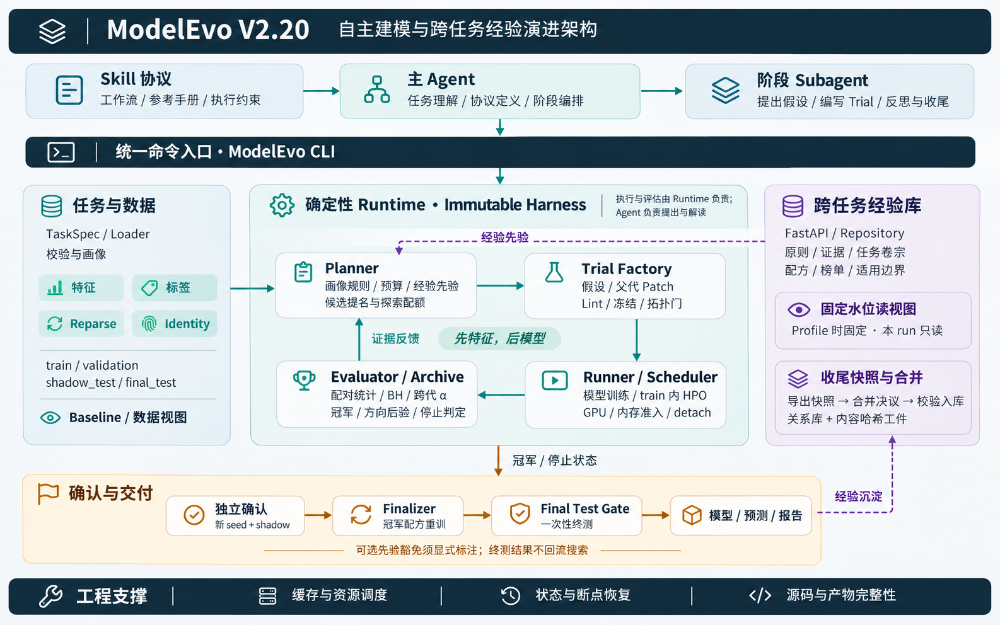

# ModelEvo V2.20

ModelEvo 是面向结构化 / 表格监督学习任务的自动建模 Agent，支持**二分类、回归和 uplift**。
给定样本、目标定义和切分策略，它在预算内自主探索特征、数据视图、模型与超参数，
交付重训模型、预测和实验报告，并保留可复现、可审计的实验记录。

核心理念是 **LLM 提案，Runtime 代码裁决**：Agent 理解任务、提出假设并编写特征和建模代码；
确定性 Runtime 负责数据隔离、训练、统计裁决与交付。

[快速开始](#快速开始) · [架构与流程](#架构与流程) · [效果](#效果) · [文档导航](#文档导航)

## 核心特点

- **自主搜索**：基于LLM先探索特征和数据视图，再搜索模型与超参数；按代批量试验，结合结果调整方向。
- **可信评估**：通过配对统计、选择校正和独立确认控制偶然选优风险，最终留出集只评估一次，确保评估置信。
- **跨任务经验复用**：可选经验库保存原则、证据与模型配方，供后续任务检索、验证和 warm-start。

适合有明确标签定义与验证方案、需要持续探索并交付模型的任务。
一次性描述统计、缺少可靠标签或验证方案的分析不在主要适用范围内。


## 快速开始

用户负责准备数据、和确认业务定义；Agent 按 Skill 协议进行自动建模。
日常使用通过自然语言发起，无需手工逐条执行搜索命令。

### 1. 准备 Python 环境（首次使用）

建议 Python 3.10 及以上。从本仓库根目录执行：

```bash
python3 -m venv .venv
source .venv/bin/activate
python -m pip install -r runtime/requirements.txt
python scripts/modelevo.py --version
```

后续启动 Coding Agent 时保持该环境已激活。


### 2. 安装 Skill（首次使用）

以下以 Claude Code 的用户级 Skill 目录为例，在仓库根目录建立链接。
首次安装时，目标路径 `~/.claude/skills/modelevo` 应尚不存在；已安装则复用现有目录。

```bash
mkdir -p "$HOME/.claude/skills"
ln -s "$PWD" "$HOME/.claude/skills/modelevo"
```


### 3. 提供数据与启动任务

将样本放在数据项目的 `data/` 目录，也可以提供已有数据的绝对路径。
在已激活上述 Python 环境的终端中进入数据项目目录，启动 Coding Agent，发送例如：

```text
使用 modelevo skill 针对 data/ 这份数据建立客户流失二分类模型。
label=1 表示客户在 T+30 天内流失。
以 AUC 为主指标。
```

Agent 会自动检查样本结构、补全任务协议；目标定义、时间边界、切分方式或泄漏列需要业务判断时，
会向用户确认。若预算内没有通过确认的候选，会报告未确认状态。
完整执行协议见 [SKILL.md](SKILL.md) 和[阶段手册](references/stage-playbook.md)。

### 4. 查看交付结果

在运行目录中优先查看 `report/report.html`（训练历程）、`report/report.md`（结果摘要）
和 `final-model/`（重训模型与预测）。确认交付状态及最终评估结果后再使用模型。
`trials/*/model/` 是搜索阶段工件；未确认的重训产物位于 `final-model/unconfirmed/`，
不代表已通过正式交付门。

### 5. 启用经验库（可选）

[全局配置](assets/global-config.yaml)中将 `modelevo.library.service.root` 改为自己的可写目录。
然后在该skill目录通过以下命令启动经验服务。

```bash
python -m pip install -r service/requirements.txt
python scripts/modelevo.py library serve --daemon   # 默认 127.0.0.1:18765
python scripts/modelevo.py library status
# 需要停止时：python scripts/modelevo.py library stop
```


## 架构与流程



| 层 | 主要职责 |
|---|---|
| Agent / Skill | 理解业务目标、定义协议、提出假设、编写 Trial、解释结果与整理经验 |
| CLI | 统一命令入口，驱动阶段与状态转换 |
| Data | 样本画像、泄漏审计、切分与特征 / 标签 / reparse / identity 隔离 |
| Planner / Trial Factory | 提名候选、分配预算，检查代码与模型拓扑 |
| Runner / Scheduler | 模型训练、HPO、并发与资源准入 |
| Evaluator / Archive | 统计裁决、冠军与探索方向维护、停止建议 |
| Finalizer | 重训冠军配方、一次性最终评估、生成模型与报告 |
| 经验库（可选） | 固定水位检索、历史配方复用、快照提交与可撤销合并 |

默认流程：

```text
定义任务与切分 → 校验与画像 → 基线（可选历史配方 warm-start）
  → 特征与数据视图探索 → 模型与超参搜索 → 独立确认
  → 重训 → 一次性 final_test 评估 → 模型、预测与报告
  → 经验快照与合并（启用经验库时）
```

运行只应使用可信 Trial 代码与依赖。数据面隔离、Lint 与产物校验不替代操作系统级隔离；
Trial Python 继承宿主进程的文件、网络和子进程权限。

## 与 V1（`model-skills`）的关系

| 维度 | V1 `model-skills` | V2.20 ModelEvo |
|---|---|---|
| 定位 | Skill 化建模流程 | 自主搜索、可信评估与跨任务经验积累 |
| 形态 | 22 个 Skill，按路径与 manifest 接力 | 1 个 Skill + 统一 CLI 与状态机 |
| 优化方式 | 跑通 baseline 后由人选择调参 / 特征筛选 / 换算法 | Planner 逐代提名，Agent 写实验，直到停止判定 |
| 特征工程 | 特征匹配 + PSI/IV/缺失率筛选（减法） | LLM 写特征块、数据视图（加法） |
| 选优 | OOT 指标横向对比 | 配对 bootstrap、同代 BH、跨代 alpha、新 seed 确认、final_test 只碰一次 |
| 任务 | 二分类、uplift | 二分类、回归、uplift |
| 经验 | 静态知识库 `model-knowledge` | 经验库服务：证据计分、分级检索、配方 warm-start |

## 目录结构与开发

```text
<skill-root>/
├── SKILL.md              # Agent 主工作流与核心不变量(Skill 入口)
├── scripts/
│   ├── modelevo.py       # CLI 入口
│   ├── _mvo/             # 各子命令实现
│   └── benchmark/        # 公开数据集评测:prepare、冷启动驱动、AIDE / raw-agent 对照
├── runtime/              # 确定性 Harness:数据/规划/训练/评估/交付
│   └── library/          # 经验库存储、检索、证据、合并、迁移(Alembic)
├── service/              # 经验库 HTTP 服务(FastAPI)、Dockerfile、compose 样例
├── assets/               # 全局配置、Trial Lint、guard hook、报告模板
├── references/           # 按需加载的协议与操作手册
├── docs/                 # 版本开发文档、复盘与汇报材料
├── diagrams/             # 架构图
└── tests/                # pytest 用例
```

在已安装 Runtime 依赖的开发环境中运行测试：

```bash
python -m pip install pytest
python -m pytest -q tests
```


## 效果

### 公开数据集：冷启动建模

在 5 个公开数据集上关闭历史经验、固定切分，所有系统在同一批测试集样本上评分。
下表为各系统的单模型结果；AUC 越大越好，RMSE 越小越好。

| 数据集（指标） | ModelEvo | AIDE 单模型 | raw-agent 单模型 | AutoGluon 单模型 | FLAML | TabPFN v2 |
|---|---|---|---|---|---|---|
| home_credit（AUC） | **0.79315** | 0.76813 | 0.76773 | 0.77318¹ | 0.78634¹ | 0.73524² |
| creditcard（AUC） | **0.99601** | 0.98654 | 0.99423 | 0.92278 | 0.96664 | 0.98399² |
| amazon（AUC） | **0.87980** | 0.86979 | 0.86044 | 0.82792 | 0.81435 | 0.76180 |
| house_sales（log1p RMSE） | 0.17804 | 0.17610 | 0.18264 | 0.17836 | 0.17844 | **0.17026** |
| adult（AUC） | 0.92423 | 0.92305 | **0.92610** | 0.90409 | 0.91991 | 0.90881 |
| 平均名次（6 个单模型条目） | **1.60** | 2.80 | 3.40 | 4.60 | 4.20 | 4.40 |

在本次评测口径下，ModelEvo 的单模型平均名次最佳。
完整数值见[效果榜单](docs/MODELEVO_V2_20_0_performance.md)，


### 内部数据集：历史配方复用

在内部时间切分的信贷动支预测任务中，已完成交付的历史运行效果如下。
增益为各 run 的测试集 AUC 相对其基线的绝对提升。

| 是否有历史经验 | AUC 绝对提升 |
|---|---|
| 无历史经验 | +0.0067～+0.0094 |
| 有历史经验 | +0.0127～+0.0133 |

- 基于历史经验的任务 AUC 增益显著高于无历史经验库的版本，效果提升更高，结果更稳定。增益主要来自历史搜索中积累的有效特征配方复用，典型运行中贡献占 90% 以上，使新一轮建模能够直接从较优方案起步。这表明经验库已能将历史探索成果转化为可重复利用的建模资产，同时改善效果、稳定性与迭代效率。
- 本框架也没办法保证自动搜索到效果天花板。


## 文档导航

- **开始与执行**：[SKILL.md](SKILL.md) · [命令与编排契约](references/protocol-digest.md) · [阶段手册](references/stage-playbook.md)
- **任务与数据**：[数据协议](references/task-and-data.md) · [任务类型约定](references/task-type-conventions.md) · [分类](references/task-type-classification.md) · [回归](references/task-type-regression.md) · [uplift](references/task-type-uplift.md)
- **搜索与实现**：[特征探索](references/feature-exploration.md) · [搜索与评估](references/evolution-and-evaluation.md) · [Trial 模板 API](references/template-api.md)
- **经验库**：[经验与记忆](references/experience-and-memory.md) · [合并协议](references/experience-library-merge.md)
- **评测与分析**：[公开榜单](docs/MODELEVO_V2_20_0_performance.md) · [天花板估计](references/benchmark.md)
